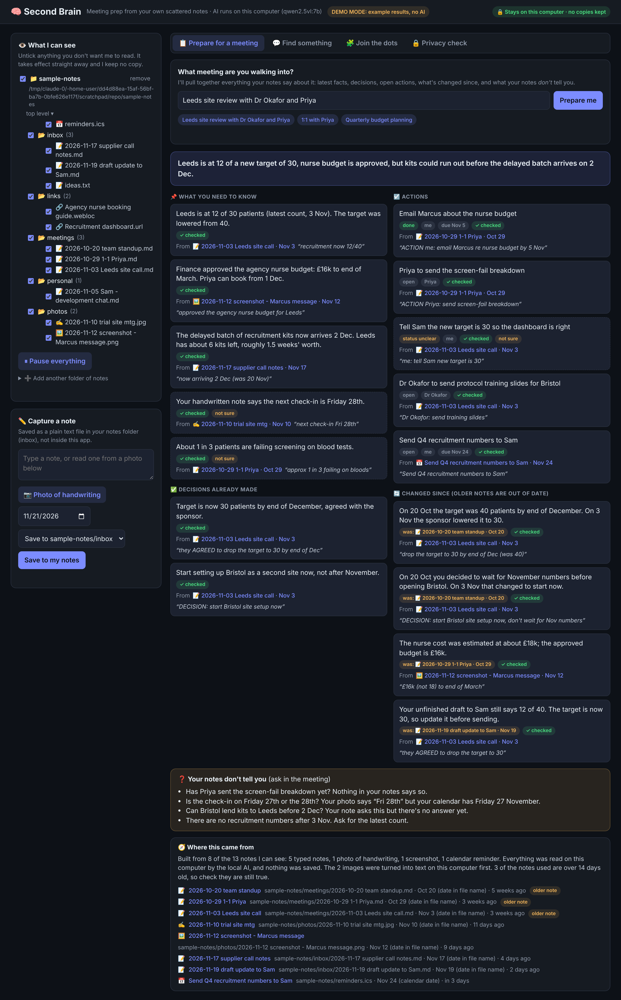
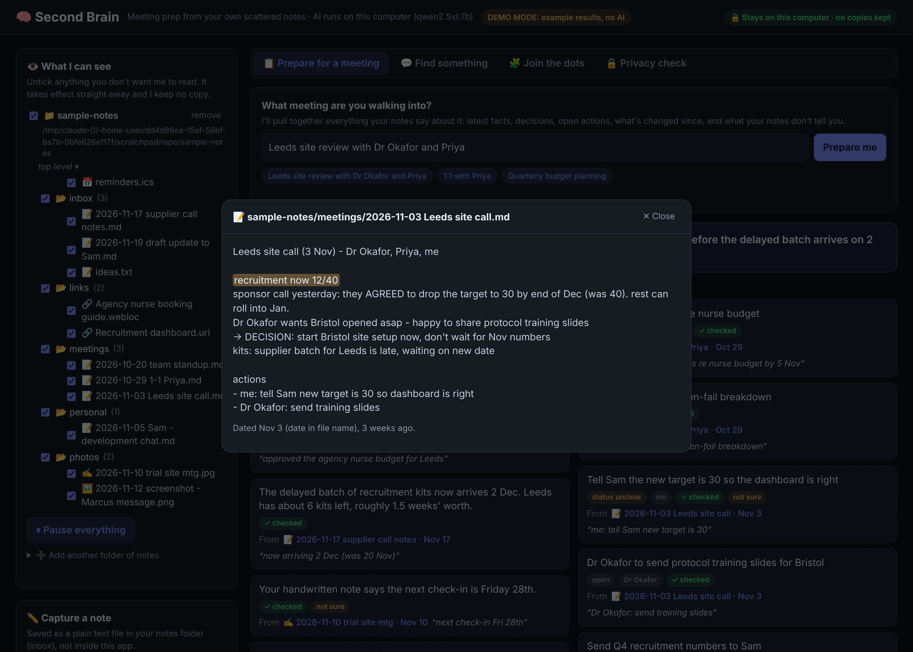
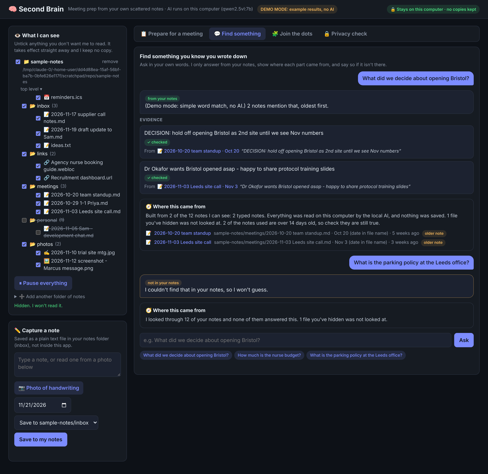
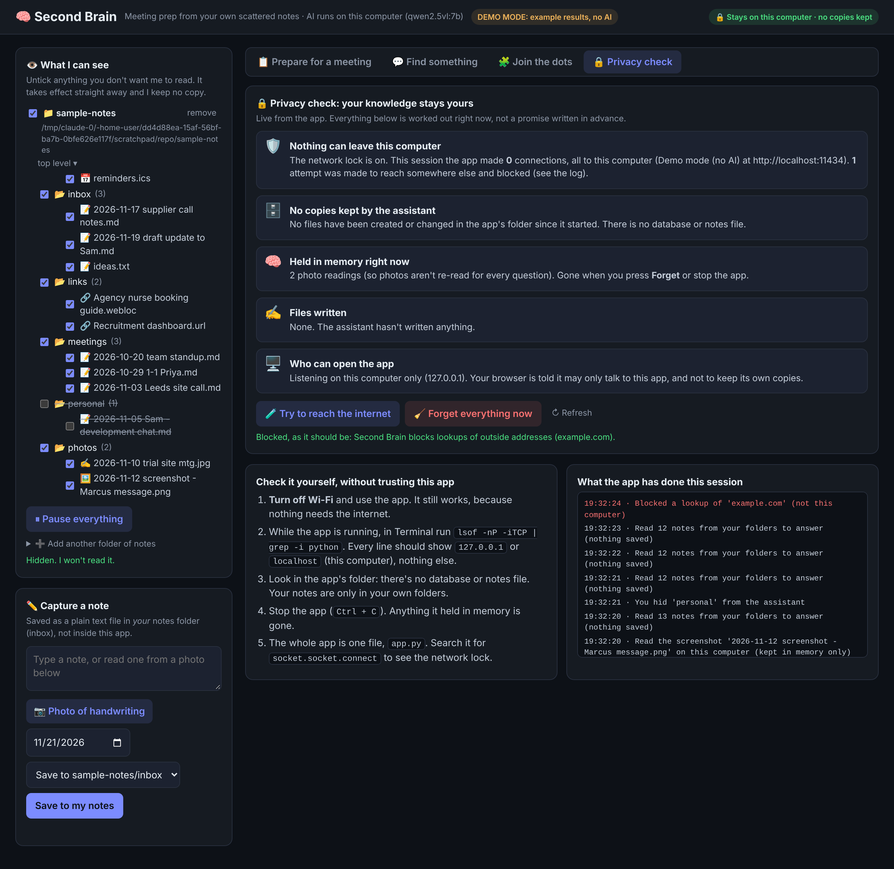

# 🧠 Second Brain: meeting prep from your own scattered notes

A personal AI assistant for a manager whose notes are everywhere: meeting notes, half-written emails, photos of handwriting, screenshots, saved links and calendar reminders. You type the meeting you're about to walk into, and in about a minute it gives you a one-page brief from **your own notes**:

- 📌 the latest facts that matter for that meeting
- ✅ decisions already made (the latest version only)
- ☑️ open actions, who owns them, and which are overdue or already done
- 🔄 what has **changed** since your older notes, so you don't quote an out-of-date number
- ❓ what your notes **don't** tell you, as questions to ask in the meeting

Every line shows the exact words it came from. You can click to open the note with those words highlighted. The app checks those words really are in your note, and marks anything it can't match as ⚠ unchecked.

**The one rule: your knowledge stays yours.** The AI runs on your own computer through [Ollama](https://ollama.com). The app blocks every network connection that isn't to your computer. It keeps no copy of your notes: no database, no cache file, no history. You choose which folders it can see, and you can change your mind at any time.



---

## How it meets the judging criteria

| Criterion | What the app does |
|---|---|
| **Insight & problem understanding** | It focuses on one real moment: *"I've got the Leeds site review in 10 minutes. What did we agree, what's changed, what's still open?"* It covers all four places notes break down: **capture** (jot a note or photo into your own folder), **find** (ask in your own words), **connect** (join the dots between notes from different places and dates) and **trust** (the privacy check). |
| **Creative use of AI & design** | It's not a chatbot over your notes. It builds a structured brief, works out which older notes are out of date ("target was 40, now 30"), spots conflicts (your photo says *Fri 28th*, your calendar says *Friday 27th*), notices unfinished drafts that still have old numbers, and lists what's missing. It handles messy notes: fragments, typos, `??`, undated files and handwriting. |
| **Working end to end** | It runs on a Mac with a local model and comes with made-up sample notes for a fictional manager. It reads **five kinds of notes**: typed notes (`.md` / `.txt`), photos of handwriting and screenshots (`.jpg` / `.png`), saved links (`.url` / `.webloc`) and calendar reminders (`.ics`). |
| **Trust & explainability** | Every point shows the note it came from and the exact quote, and the app checks the quote is really there. It flags numbers that aren't in the note, marks things it isn't sure about, and says *"I couldn't find that in your notes"* instead of guessing. A **🧭 Where this came from** box explains, in plain words, which notes it used, how old they are, which were photos and which you'd hidden. |
| **Knowledge stays yours** | **On device:** a network lock blocks anything that isn't your computer, and the AI must be local. **No copies:** notes are read fresh from your folders and nothing is stored. **You're in control:** tick or untick any folder or file, pause everything, or add and remove folders. **You can check it:** the 🔒 Privacy check page shows live what the app connected to, what it blocked, what it wrote (nothing) and what it holds in memory. It has a button to try reaching the internet (it gets blocked), a **Forget everything now** button, and steps to verify it yourself without trusting the app. |

---

## Setup on a Mac (about 15 minutes, mostly downloading)

You'll type a few commands into **Terminal** (press `⌘ + Space`, type `Terminal`, press Enter).

### 1. Install Ollama and download a model

1. Download Ollama from <https://ollama.com/download>, open it and drag it into Applications. Open the Ollama app once (a small llama icon appears in the menu bar).
2. In Terminal, download a model that can read images:

   ```bash
   ollama pull qwen2.5vl:7b
   ```

   It's about 6 GB. On an 8 GB Mac use `qwen2.5vl:3b` instead, and put `OLLAMA_MODEL=qwen2.5vl:3b` in your `.env` file (step 3).

### 2. Get the code

Download the ZIP (signed in to GitHub): <https://github.com/CormGt/Pfizer-hack/archive/refs/heads/main.zip>, then double-click it in Downloads to unzip it.

### 3. Install and run the app

```bash
cd ~/Downloads/Pfizer-hack-main
python3 -m venv .venv
source .venv/bin/activate
pip install -r requirements.txt
cp .env.example .env
python app.py
```

Open **<http://localhost:5050>** in your browser.

Next time, you only need:

```bash
cd ~/Downloads/Pfizer-hack-main
source .venv/bin/activate
python app.py
```

Press `Ctrl + C` in Terminal to stop the app. Anything it held in memory goes with it.

> **No AI installed yet?** Run `DEMO_MODE=1 python app.py` to click around with example results. The screenshots in this guide come from demo mode.

### Using your own notes

The app starts with the made-up notes in `sample-notes/`. To use a real folder, either:

- type its location into **➕ Add another folder of notes** in the app (e.g. `~/Documents/Meeting notes`), or
- set `NOTES_FOLDERS=~/Documents/Meeting notes` in `.env`.

Files whose names start with `_` or `.` are ignored. If a file name has a date in it like `2026-11-03 Leeds call.md`, that's used as the note's date. Otherwise it uses the date the file was last changed, and says so.

**Coming from the old version?** Your notes are in `notes.json`. Run `python export_old_notes.py ~/Documents/My notes` to turn them into normal files, then add that folder. The new version never reads or writes `notes.json`.

---

## Demo walkthrough (about 3 minutes)

The sample notes belong to **Jordan**, a fictional clinical operations manager running patient recruitment at a Leeds trial site, with a second site in Bristol being set up. They're deliberately messy. There's a target that changed, a cost that changed, an unfinished email with an old number, an undated ideas file, a handwritten page, a screenshot of a chat message, two saved links, a calendar with the review meeting, and a private folder (`personal/`).

**1. Prepare for a meeting.** Click **Leeds site review with Dr Okafor and Priya**. The brief says Leeds is at 12 of a *new* target of 30. It shows that the nurse budget was approved at £16k (from the **screenshot**), that kits could run out before the delayed batch arrives, and that the "email Marcus" action is already done. Under 🔄 *Changed since*, it catches that the target dropped from 40 to 30, that the Bristol decision changed, and that the unfinished email to Sam still says 40. Under ❓ *Your notes don't tell you*, it lists what to ask, including that the photo says "Fri 28th" but the calendar says Friday 27th.

**2. Click any source.** The note opens with the exact words highlighted. For a photo, you see the image and the text the local AI read from it.



**3. Change what it can see.** Untick `personal` on the left. It's struck through, and from now on the assistant can't read it or open it. The *Where this came from* box says "1 file you've hidden was not looked at."

**4. Find something, and see it be honest.** In **💬 Find something**, ask *"What did we decide about opening Bristol?"* and you'll see both the old and the new decision, with dates. Then ask *"What is the parking policy at the Leeds office?"* and it says it couldn't find that in your notes, so it won't guess.



**5. Join the dots.** **🧩 Join the dots** shows the running threads of work and links you might have missed, like the kit delay that affects the Bristol plan.

**6. Prove the rule.** Open **🔒 Privacy check**. It shows every connection went to this computer, no files were created in the app's folder, and what's held in memory. Press **🧪 Try to reach the internet** and the log turns red: *Blocked*. Press **🧹 Forget everything now** and the memory count goes to 0. For extra proof, turn off Wi-Fi and run the brief again. It still works.



---

## How the one rule is kept (for the technical judges)

All of this is in `app.py`, which is one file.

- **Network lock.** At start-up, before anything else loads, `socket.socket.connect`, `connect_ex` and `socket.getaddrinfo` are wrapped. Only loopback addresses (127.0.0.1, ::1, localhost) are allowed. Anything else raises an error and goes into the session log. `OLLAMA_URL` must be local or the app won't start. Proxies are ignored for the Ollama call.
- **Browser lock.** Every page is sent with a Content-Security-Policy that lets the page talk only to the app (no outside scripts, fonts or requests), plus `Cache-Control: no-store` so the browser doesn't keep copies, and `Referrer-Policy: no-referrer`.
- **Only this computer can open it.** The server listens on 127.0.0.1 unless you turn on `PHONE_ACCESS=1`.
- **No copies.** There's no database. Notes are read from your folders for each request and dropped afterwards. The only thing kept is the text read from photos, held in memory so a photo isn't re-read for every question. It's cleared by **Forget** or by stopping the app. Notes you *capture* are saved as plain `.md` files in **your** folder's `inbox/`, never inside the app. The Privacy check scans the app's folder for any file created or changed since start-up.
- **Access control.** Folder and file visibility is checked on every read, including when you open a source. Hidden files are never sent to the AI (there's a test for this).
- **Checking the AI.** The model must answer in a fixed JSON shape. Each item names one note id and a quote. The server drops items that cite a note that doesn't exist and marks an item ⚠ unchecked if its quote isn't in that note or it contains a number the note doesn't. If nothing checks out, it says it isn't sure, or that nothing was found.
- **Ollama** runs the model on your Mac. It doesn't keep your prompts or conversations. The Ollama app may check online for its own updates, but that never includes your notes, and this app never sends anything there.

## Running the automated checks

```bash
source .venv/bin/activate
python -m unittest discover tests
```

There are 19 checks. They cover the network lock, that nothing is written, hidden folders never reaching the AI, pause, made-up quotes and numbers being flagged, invented notes being dropped, overdue actions and capture saving into your folder. They use a pretend Ollama, so no model is needed.

## Troubleshooting

- **"Can't reach Ollama"**: open the Ollama app, and make sure `ollama pull qwen2.5vl:7b` has finished.
- **It's slow**: local models take a while, especially the first time (loading) and when reading photos. Hide folders you don't need, or use `qwen2.5vl:3b`.
- **iPhone photo rejected**: Settings > Camera > Formats > **Most Compatible** (JPG, not HEIC).
- **Port in use**: `PORT=5051 python app.py`.
