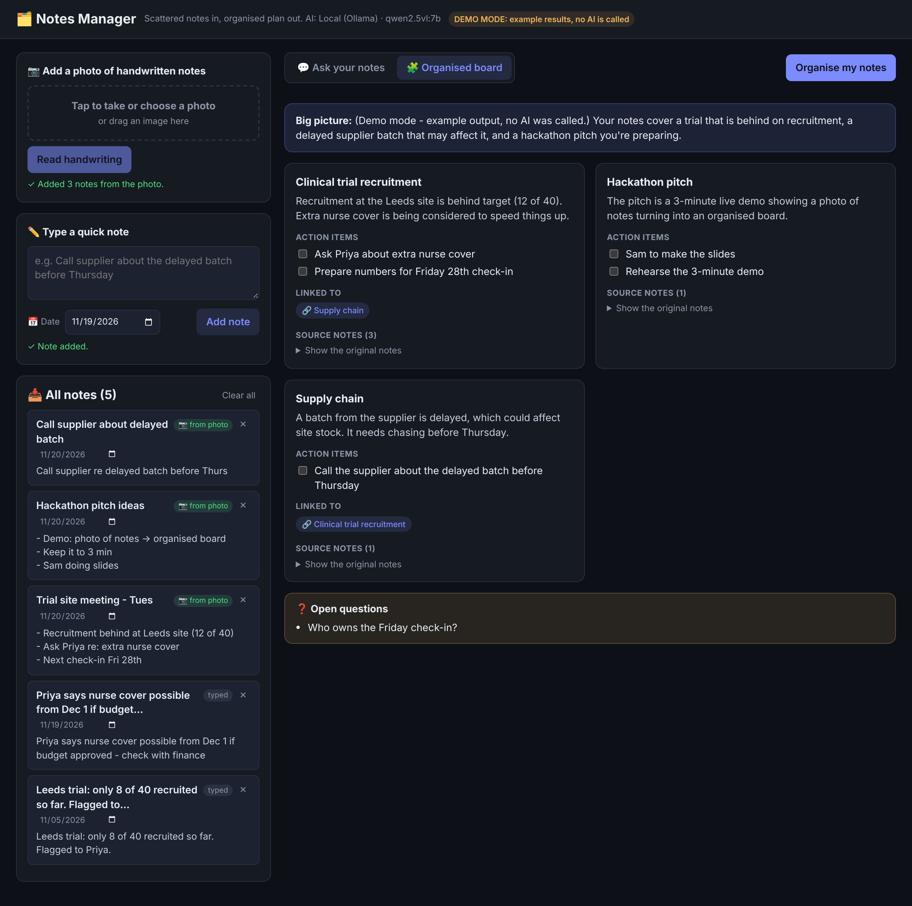
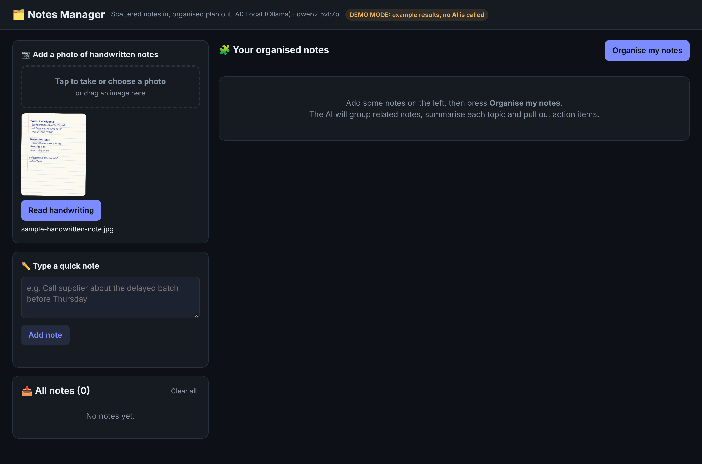
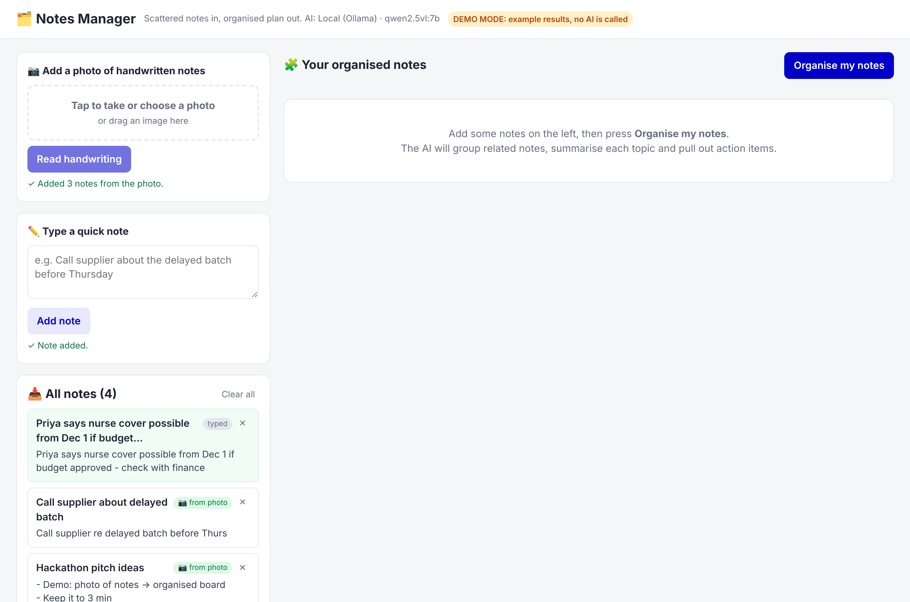
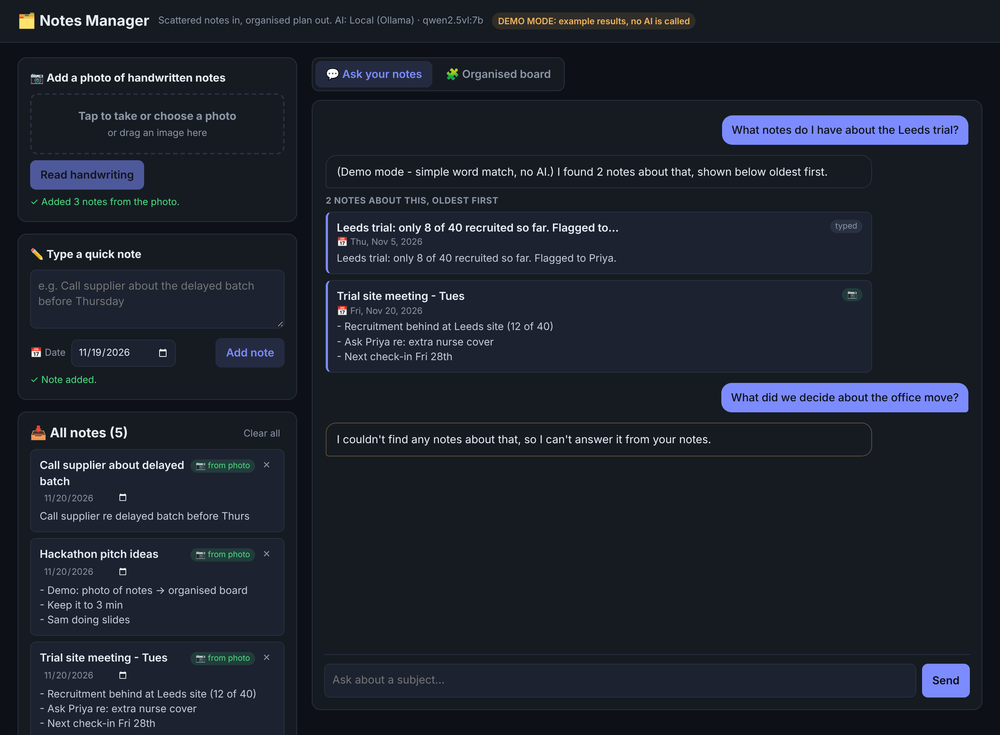

# 🗂️ Notes Manager

An AI assistant that pieces together scattered notes. Type a quick note, or snap a photo of your handwritten notes. The AI reads the handwriting, then groups related notes into topics, summarises each one, pulls out action items and links topics that connect. You can also **chat with your notes**: ask about a subject and it pulls up every note about it, in date order. If your notes don't cover something, it says so instead of making something up.

**It runs entirely on your own computer.** By default it uses a free local AI model through [Ollama](https://ollama.com), so your notes never leave your machine and you don't need an API key. You can switch to Claude (Anthropic's API) with one setting if you want stronger results.



---

## Setup on a Mac (about 15 minutes, mostly downloading)

You'll type a few commands into **Terminal** (press `⌘ + Space`, type `Terminal`, press Enter).

### 1. Install Ollama and download a model

1. Download Ollama from <https://ollama.com/download>, open the file and drag it into Applications. Open the Ollama app once (you'll see a small llama icon in the menu bar at the top of the screen).
2. In Terminal, download a model that can read images:

   ```bash
   ollama pull qwen2.5vl:7b
   ```

   This is about 6 GB, so it takes a while. A Mac with 16 GB of memory or more is comfortable. On an 8 GB Mac, use the smaller `qwen2.5vl:3b` instead, and put `OLLAMA_MODEL=qwen2.5vl:3b` in your `.env` file (step 3).

### 2. Get the code

```bash
git clone https://github.com/CormGt/Pfizer-hack.git
cd Pfizer-hack
```

(If `git` asks you to install the developer tools, click Install and run the command again.)

### 3. Install and run the app

```bash
python3 -m venv .venv
source .venv/bin/activate
pip install -r requirements.txt
cp .env.example .env
python app.py
```

Open **<http://localhost:5050>** in your browser. That's it.

Next time, you only need:

```bash
cd Pfizer-hack
source .venv/bin/activate
python app.py
```

Press `Ctrl + C` in Terminal to stop the app.

### Using your phone's camera

Your phone can snap notes straight into the app if it's on the same Wi-Fi as your Mac. When the app starts, Terminal prints a line like `Running on http://192.168.1.23:5050`. Open that address in your phone's browser and tap **Tap to take or choose a photo**.

> iPhone tip: if a photo is rejected, go to Settings > Camera > Formats and choose **Most Compatible** (the app needs JPG or PNG, not HEIC).

---

## Walkthrough with an example

A sample handwritten page is included at [`examples/sample-handwritten-note.jpg`](examples/sample-handwritten-note.jpg). It has three separate things on it: notes from a trial site meeting, ideas for a hackathon pitch, and a reminder to call a supplier.

> The screenshots below were taken in demo mode (`DEMO_MODE=1`), which shows example results without calling any AI. With Ollama or Claude switched on, the real AI produces the same kind of results from your own photos.

**1. Add a photo.** Click **Tap to take or choose a photo** (or drag the image onto that box), choose the sample image, then press **Read handwriting**.



**2. The AI reads it.** It splits the page into separate notes, one per idea, and adds them to **All notes**, tagged *📷 from photo*. If any word was hard to read, it's marked `[?]` and listed under the button so you can fix it. Here I also typed one quick note: *"Priya says nurse cover possible from Dec 1 if budget approved - check with finance"*.



**3. Organise.** Press **Organise my notes**. The AI pieces everything together:

- **Big picture**: a short summary across all your notes.
- **Topic cards**: related notes grouped together. The typed note about Priya was put with the handwritten trial meeting note, because they're about the same thing.
- **Action items** with tick boxes for each topic.
- **Linked to**: click a link to jump to a related topic (here, the delayed supplier batch is linked to trial recruitment).
- **Source notes**: open this to see the original notes behind a topic.
- **Open questions**: things that are unclear or missing.


**4. Ask your notes.** Open the **💬 Ask your notes** tab and ask about any subject, for example *"What notes do I have about the Leeds trial?"*. The AI answers using only your notes and shows every note on that subject as a timeline, oldest first, with dates. If nothing in your notes covers the question, it says so. It never makes up an answer: if the AI's reply isn't backed by at least one of your notes, the app replaces it with *"I couldn't find any notes about that."*



**Dates.** Every note has a date. Typed notes use the date picker next to **Add note** (today by default). For photos, the AI uses any date written on the page, otherwise today. Click the date on any note in **All notes** to change it.

Add more notes at any time. The app tells you how many notes are new since you last organised, and you press **Organise my notes** again to update the board. Everything is saved in `notes.json`, so it's still there when you restart.

---

## Settings (`.env` file)

The `.env` file holds your settings. Open it in any text editor (in Terminal: `open -e .env`).

| Setting | What it does |
| --- | --- |
| `AI_PROVIDER=ollama` | Use a local model through Ollama (default). |
| `AI_PROVIDER=claude` | Use Claude through the Anthropic API instead. Needs `ANTHROPIC_API_KEY`, Python 3.10 or newer, and one extra install: `pip install -r requirements-claude.txt`. |
| `OLLAMA_MODEL` | Which Ollama model to use. It must support images. Default `qwen2.5vl:7b`. Others to try: `qwen2.5vl:3b` (smaller, faster), `gemma3:12b`, `llama3.2-vision`. Download a model first with `ollama pull <name>`. |
| `ANTHROPIC_API_KEY` | Your Claude API key, from <https://console.anthropic.com/settings/keys>. Paste it after the `=` with no quotes. Only needed for `AI_PROVIDER=claude`. |
| `CLAUDE_MODEL` | Default `claude-opus-5-5`. |
| `DEMO_MODE=1` | Try the app with example results and no AI at all. |
| `PORT` | Default `5050`. |

**Keep your API key secret.** The `.env` file is listed in `.gitignore`, so it won't be uploaded to GitHub.

### Local vs Claude

| | Ollama (local) | Claude |
| --- | --- | --- |
| Cost | Free | Pay per use |
| Privacy | Notes never leave your Mac | Sent to Anthropic's API |
| Works offline | Yes | No |
| Speed | 20 seconds to a few minutes per photo, depending on your Mac | Usually 10-30 seconds |
| Messy handwriting | Good on neat writing, weaker on messy writing | Strong |

A good hackathon plan: build and demo with Ollama, and keep Claude as a backup for very messy handwriting.

---

## Troubleshooting

| Message | Fix |
| --- | --- |
| *Can't reach Ollama* | Open the Ollama app (llama icon in the menu bar), or run `ollama serve` in a separate Terminal window. |
| *Ollama doesn't have the model…* | Run `ollama pull qwen2.5vl:7b` (or whatever `OLLAMA_MODEL` is set to). |
| *Address already in use* | Something else is using port 5050. Put `PORT=5051` in `.env` and open <http://localhost:5051>. |
| Reading a photo is very slow | The first request loads the model into memory and is slowest. Try `qwen2.5vl:3b`, or a smaller or cropped photo. |
| *No Anthropic API key found* | You set `AI_PROVIDER=claude`. Add your key to `.env`, or switch back to `ollama`. |
| `No matching distribution found for anthropic` | You're on an older version of the code. Download it again. The local (Ollama) setup works with the Python that comes with your Mac. |
| `python3: command not found` | Install Python from <https://www.python.org/downloads/>. |

---

## How it works

- `app.py` is a small [Flask](https://flask.palletsprojects.com) web server.
  - `POST /api/photo` sends the photo to the AI with instructions to transcribe the handwriting and split it into separate notes.
  - `POST /api/organise` sends all notes to the AI and asks it to group them into topics, with summaries, action items, links and open questions.
  - `POST /api/chat` sends your question and your notes (with dates) to the AI. It must answer only from the notes and list the id of every note it used. Answers that cite no real note are replaced with "no notes found".
  - Both ask for a fixed JSON shape (a "schema"), so the answers always fit the page.
- `templates/index.html` is the whole web page (HTML, CSS and JavaScript in one file).
- Notes are saved in `notes.json`.

## Project files

```
app.py                         the server and the AI calls
templates/index.html           the web page
requirements.txt               Python packages to install
requirements-claude.txt        extra package, only for AI_PROVIDER=claude
.env.example                   settings template (copy to .env)
examples/                      a sample handwritten note to try
docs/screenshots/              screenshots used in this README
```
